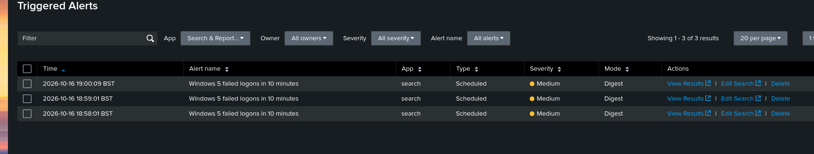
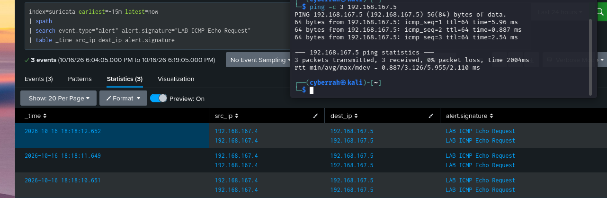
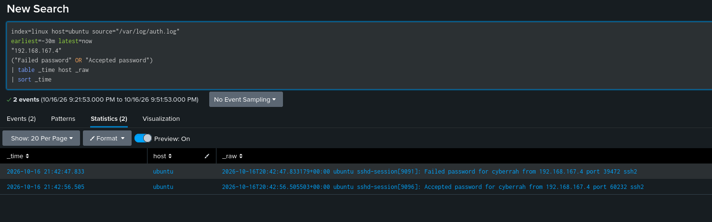
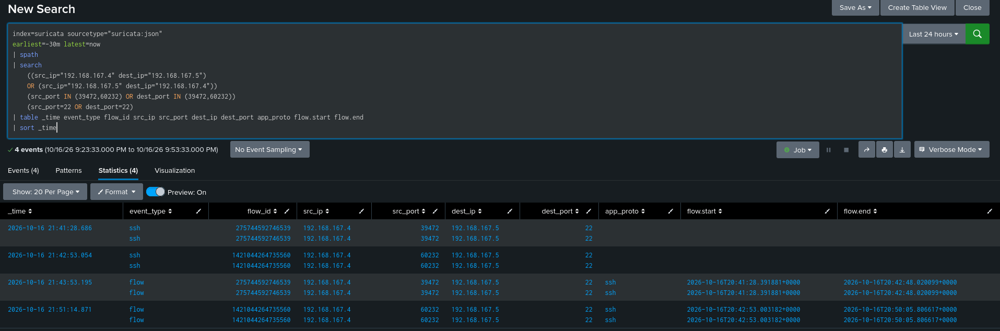
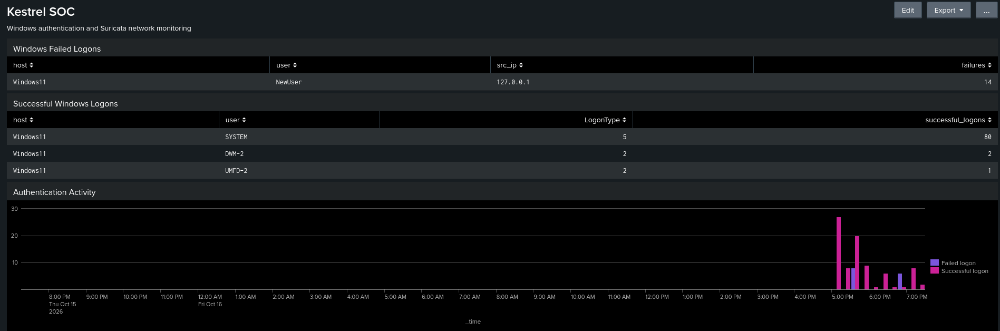
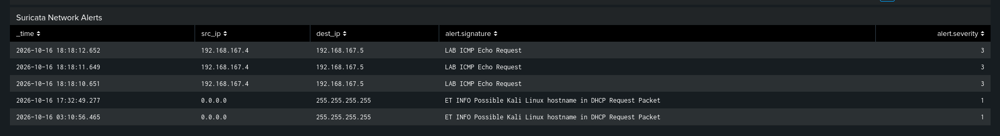

# Splunk and Suricata SOC Home Lab

**Author: Abdul Rahman Sesay · Evidence date: 16 October 2026**

A three-VM security monitoring lab using Splunk Enterprise, Universal Forwarders and Suricata to collect endpoint and network telemetry, detect repeated Windows logon failures, and investigate SSH activity across host and network logs.

The project uses **Kestrel Logistics Group as a fictional logistics case study**. All tests were performed in an authorised VirtualBox home lab. No malicious compromise was established.

## Project highlights

- Collected Windows Security and System events, Ubuntu authentication and system logs, Suricata EVE JSON, and Splunk internal telemetry.
- Validated a scheduled detection for at least five Windows failed logons in ten minutes.
- Built the **Kestrel SOC** dashboard to show authentication activity and network alerts.
- Matched a failed SSH password and a subsequent successful login to two Suricata connections using timestamps, IP addresses and source ports.
- Documented troubleshooting, evidence, coverage limits and improvements.

**[Read the final SOC report](reports/Kestrel_SOC_Investigation_Report.pdf)** · **[View the source inventory](inventory/Kestrel_Log_Source_Inventory.xlsx)** · **[Read the SSH investigation](docs/ssh-investigation.md)**

## Lab architecture

| VM | Lab IP | Role |
|---|---|---|
| Kali Linux | `192.168.167.4` | Splunk Enterprise receiver and controlled test client |
| Ubuntu | `192.168.167.5` | Suricata on `enp0s8`, Linux logs and Universal Forwarder |
| Windows11 | `192.168.167.6` | Windows event logs and Universal Forwarder |

Both Universal Forwarders send to the Splunk receiver on TCP `9997`. Splunk Web uses port `8000`. The demonstrated sensor visibility covers traffic addressed to Ubuntu; visibility of every Kali-to-Windows exchange was not established.

## Technologies

Splunk Enterprise · Splunk Universal Forwarder · SPL · Suricata · EVE JSON · Windows Event Logs · Ubuntu · OpenSSH · Kali Linux · Oracle VirtualBox

## Final log source inventory

| Origin | Source | Index | Sourcetype |
|---|---|---|---|
| Windows11 | Security event channel | `windows` | `XmlWinEventLog:Security` |
| Windows11 | System event channel | `windows` | `XmlWinEventLog:System` |
| Ubuntu | `/var/log/auth.log` | `linux` | `syslog` |
| Ubuntu | `/var/log/syslog` | `linux` | `syslog` |
| Ubuntu | `/var/log/suricata/eve.json` | `suricata` | `suricata:json` |
| Kali Splunk | `/opt/splunk/var/log/splunk/` | `_internal` | Multiple platform sourcetypes |
| Windows Forwarder | Forwarder internal log directory | `_internal` | Multiple platform sourcetypes |

The workbook provides the detailed source inventory. Counts in screenshots describe their own selected time windows and should not be totalled across views.

## Workflow

1. Configure the receiver and scoped log inputs on the two forwarders.
2. Confirm the forwarding destination is active and monitored files are readable.
3. Check that raw events arrive in the intended indexes and inspect their field extraction.
4. Generate controlled Windows failed logons and ICMP traffic.
5. Validate the detection search and scheduled alert action.
6. Build dashboard panels from the validated searches.
7. Perform a controlled SSH test and correlate Ubuntu authentication outcomes with Suricata connection records.
8. Record conclusions and limitations in the report and final inventory.

## Windows failed logon detection

**Objective:** Detect five or more event `4625` records for the same host, target account and source IP within ten minutes.

```spl
index=windows sourcetype="XmlWinEventLog:Security"
"<EventID>4625</EventID>" earliest=-10m latest=now
| rex field=_raw "<Data Name='TargetUserName'>(?<user>[^<]+)</Data>"
| rex field=_raw "<Data Name='IpAddress'>(?<src_ip>[^<]+)</Data>"
| stats count as failures by host user src_ip
| where failures >= 5
```

The regex matches the single-quoted XML format supplied in this lab. Validate it against your own events before reuse.

| Setting | Validated configuration |
|---|---|
| Alert name | Windows 5 failed logons in 10 minutes |
| Type | Scheduled |
| Cron | `* * * * *` |
| Earliest / latest | `-10m` / `now` |
| Trigger | Number of results greater than `0` |
| Mode | Once per evaluation |
| Action | Add to Triggered Alerts |
| Severity | Medium |

**Observed result:** Six failures for `NewUser` from `127.0.0.1` on `Windows11` satisfied the threshold. Raw event `24120` used interactive logon type `2` with substatus `0xc000006a` (bad password).

The alert initially retained `rt-10m` and `rt-0m` dispatch bounds. Replacing them with historical bounds fixed the scheduling configuration. Scheduled alert entries were visible at **18:58:01, 18:59:01 and 19:00:09 BST**. Overlapping search windows can repeat the same activity; these entries do not establish three separate incidents. Field-based throttling is a recommended improvement.



## Suricata validation

Three controlled ICMP echo requests from Kali to Ubuntu generated three **LAB ICMP Echo Request** alerts. The corresponding ping received three replies with zero loss. This verifies the lab rule and the collection path for that traffic.



Two additional alerts described a possible Kali Linux hostname in DHCP requests. Their source was `0.0.0.0` and destination was `255.255.255.255`. A hostname signature alone does not establish exploitation. The Suricata alert severity field is a rule value, not a complete incident assessment.

## Cross-source SSH investigation

Kali initiated a controlled SSH test to Ubuntu using `cyberrah`. One password failed and a subsequent connection authenticated successfully.

| Outcome | UTC time on 16 October 2026 | Client source port | Destination |
|---|---|---|---|
| Failed password | `20:42:47.833179` | `39472` | `192.168.167.5:22` |
| Accepted password | `20:42:56.505503` | `60232` | `192.168.167.5:22` |

Ubuntu logs establish the authentication outcomes. Suricata supplied two SSH records and two flow records for those connections. Both authentication timestamps fall within the corresponding network flow intervals. The accepted password followed the failed password by approximately **8.67 seconds**.

**Interpretation:** Two sources corroborate the connections. Suricata metadata does not reveal the password outcome inside encrypted SSH. The controlled sequence is not evidence of brute force or account compromise.





See the [full correlation timeline](docs/ssh-investigation.md) and [reproduction search](detections/ssh-network-correlation.spl).

## SOC dashboard

The dashboard includes Windows failed logons, successful logons, an authentication activity chart and Suricata network alerts. Service logons and informational network signatures require context before escalation.





The dashboard screenshot contains a separate 24-hour view with 14 failures. It is not the six-event alert validation window. The screenshots demonstrate the dashboard; an exported dashboard definition is not included.

## Troubleshooting demonstrated

| Issue | Resolution or finding |
|---|---|
| No Ubuntu host log results | Add missing file monitors and confirm `splunkfwd` can read the files through `adm` membership |
| Scheduled alert did not appear | Replace real-time dispatch bounds with `-10m` and `now`; configure Add to Triggered Alerts |
| Windows field filter returned no events | Inspect raw XML and extract target username and source IP explicitly |
| Duplicate JSON field values | Verify extraction; duplicate values within a field are not additional raw events |
| Blank signature fields on network events | Restrict alert panels to `event_type=alert`; flows and stats need not contain alert signatures |

## Skills demonstrated

SIEM configuration, log source onboarding, SPL development, Windows event analysis, Linux authentication analysis, network telemetry analysis, dashboard design, alert troubleshooting, timestamp normalisation and evidence-based reporting.

## Framework context

- **MITRE ATT&CK T1110.001 — Password Guessing:** Repeated password failures are relevant to this behaviour. The Windows rule validates a simulated detection, not adversary attribution.
- **NIST CSF Detect — DE.CM and DE.AE:** Collection and analysis align with the intent of these outcomes. This is an illustrative mapping, not a compliance or certification claim.

## Limitations and improvements

- This is a lab validation, not a production deployment or penetration-test report.
- Sensor visibility for all VM-to-VM traffic paths was not demonstrated.
- No measured detection-time improvement, automated containment or production incident response is claimed.
- TLS, role restrictions, retention, licence volume and NTP configuration need separate validation.
- Tune alert suppression and field extraction before expanding the deployment.
- Screenshots and selected pasted records support the findings; forensic evidence exports and original chain-of-custody hashes were not supplied.

## Repository contents

| Location | Contents |
|---|---|
| [reports/](reports/) | Final SOC report PDF |
| [inventory/](inventory/) | Final source inventory workbook |
| [screenshots/](screenshots/) | Supplied evidence with descriptive filenames |
| [detections/](detections/) | SPL searches and alert configuration notes |
| [configs/](configs/) | Credential-free example monitor and forwarding stanzas |
| [docs/](docs/) | SSH investigation, evidence register and reproduction notes |
| [PUBLISHING.md](PUBLISHING.md) | Instructions for publishing this folder |

## References

- [Microsoft event 4625](https://learn.microsoft.com/en-us/previous-versions/windows/it-pro/windows-10/security/threat-protection/auditing/event-4625)
- [Suricata EVE JSON format](https://docs.suricata.io/en/suricata-8.0.2/output/eve/eve-json-format.html)
- [MITRE ATT&CK T1110.001](https://attack.mitre.org/techniques/T1110/001/)
- [Ubuntu OpenSSH server](https://ubuntu.com/server/docs/openssh-server/)

Only test systems you own or are authorised to assess. Configuration examples contain private lab IPs and no credentials.
